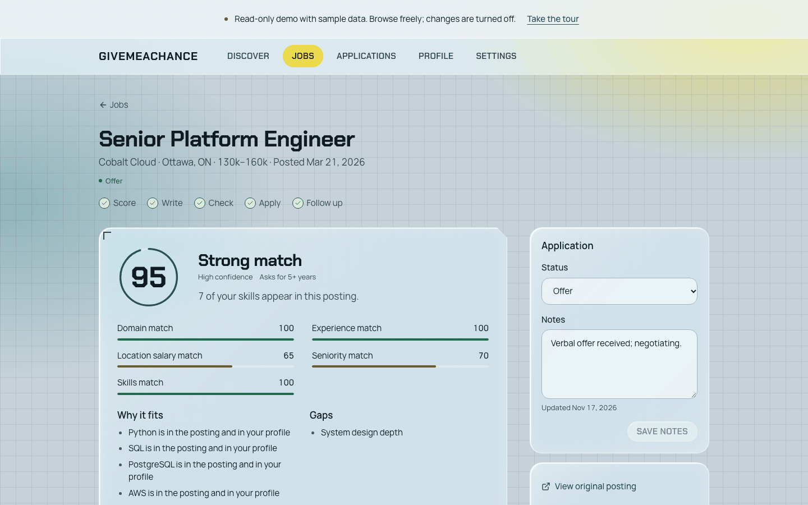
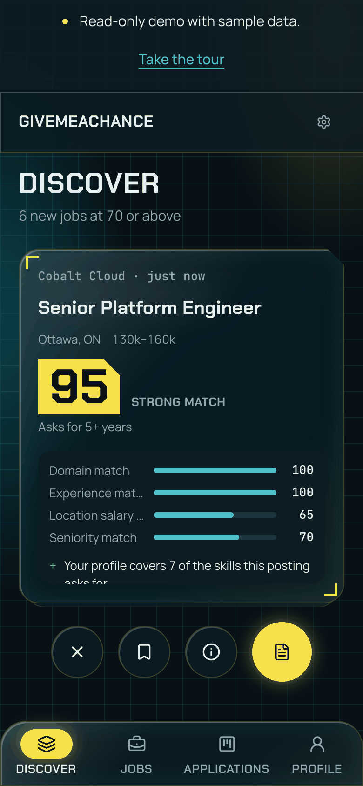
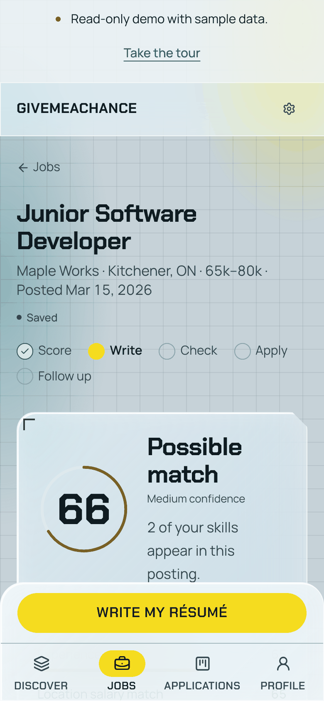
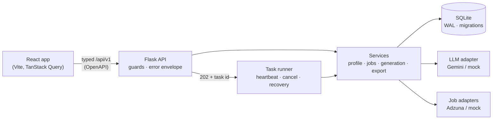

# GivemeaChance

[](https://github.com/beandecode/givemeachance/actions/workflows/ci.yml)

A job-search assistant that tells you **which jobs are worth your time and why**, and writes a tailored résumé and
cover letter only for the ones you pick.


## The problem

Applying well is slow: every posting has to be read, compared with your background and answered with a résumé that
fits it. Most tools either blast one résumé everywhere or let a model invent experience you do not have.

## What it does

1. **Builds a Master Profile** from your résumé (text, PDF, Word or image), which you review and approve. Every later
   step uses only this approved profile.
2. **Finds jobs** through the Adzuna job board with your saved filters, or takes a posting you paste, and reads each
   posting in full before judging it. Filters and a cheap relevance pass run in code before any AI call is spent.
3. **Explains the fit** of each job: a score computed in code from five rated dimensions, with strengths, gaps and
   risk flags.
4. **Lets you decide fast** in a swipe deck: write a résumé, skip, waitlist or open the details.
5. **Writes the documents** for the jobs you chose, then checks every claim against your profile and lists anything
   it could not support. Export to PDF or Word.
6. **Tracks applications** from draft to offer, with follow-up dates.

## Try it

**Live demo: <https://jobs.givemeachance.qzz.io/>** (works on a phone). It opens a read-only sample workspace with a
one-minute guided tour; press
**Try it live** to get a guest workspace where job search, scoring and document writing run on the real job board
and AI model, on a sample profile and within a small daily budget. You can also build a profile from a sample résumé
as text, PDF, Word or a screenshot, and answer the questions it raises.

The measurements behind the design are written up in the **[case study](https://jobs.givemeachance.qzz.io/case-study)** (also served by the app at `/case-study`).

Or run the same demo locally in two commands. No account, keys or setup: sample jobs, match reports, generated
documents and a filled board.

```bash
docker compose -f docker-compose.demo.yml up --build
open http://127.0.0.1:5021/app/        # every change is refused: it is a read-only demo
```

## How well it scores

Measured on 48 real Toronto postings (47 of them labelled) by hand for an early-career data-science résumé before any
score was seen ([method](docs/adr/ADR-019-full-job-descriptions.md)). "Ranked right" is the share of pairs the score
puts in the labeller's order; 0.50 is a coin flip. With this few postings the 95% intervals are wide: level 0.70 to
0.93, apply above skip 0.56 to 0.92 (only 7 postings are labelled skip). `python scripts/labelling.py report` prints
these numbers and the intervals from the labels and the saved scores. Four models are compared in
[ADR-019](docs/adr/ADR-019-full-job-descriptions.md#model-comparison-2026-11-16): the same level agreement from the
fastest and cheapest of the three newer ones, which is the one the app uses.

| | Before (preview, old model) | Now (full description, `gemini-3.5-flash-lite`) |
|---|---|---|
| Level: roles that fit ranked above roles that ask for more experience | 0.68 | 0.83 |
| Jobs the labeller would apply to ranked above jobs they would skip | 0.65 | 0.76 |
| Postings whose text states the years of experience asked for | 1 of 48 | 39 of 48 |

A score stops being capped by "3+ years" or a missing skill; only hard gates such as a required licence cap it. With
the same ranking, the roles that fit and reach the swipe deck (score 70 or more) went from 1 of 17 to 7 of 17, and
none of the 13 jobs in the deck is one the labeller would skip.

Whether to apply stays the user's choice: the score describes fit, and new graduates often apply above it.

## How it is checked

- 466 Python tests, 154 web unit tests and 55 browser tests run on every push, all on mock providers and temporary
  databases.
- The API is fuzzed against its own OpenAPI document; the web app's types are generated from the same document.
- Every screen passes automated accessibility checks (WCAG 2.1 AA) in light, dark and no-transparency modes, on
  phone, tablet and desktop sizes.
- A test probe fails any code path that holds a database write lock during a call to an AI or job-board provider.

## Screenshots

| Discover: swipe to decide | Why it fits |
|---|---|
|  |  |
| **Tailored résumé (PDF / Word export)** | **Application board** |
|  |  |
| **Résumé input: any format, nothing invented** | **Fill the gaps** |
|  |  |

Phone, light and dark mode get the same care as the desktop: one bottom dock with the tab bar and a next-step bar, a
full-height swipe deck, stage tabs instead of the board.

 

Regenerate them with `(cd web && npm run screenshots)` and `python scripts/make_readme_gif.py`.

## Architecture



## Design decisions

- **Modular monolith on SQLite** — one deployable, WAL mode, numbered migrations; a database or queue is added only
  when measured ([ADR-001](docs/adr/ADR-001-modular-monolith-first.md), [ADR-004](docs/adr/ADR-004-sqlite-then-postgresql.md)).
- **No transaction across a provider call** — the writer lock is released before every LLM or job-board request and
  state is re-checked afterwards; a test probe fails any violation.
- **Async tasks with a contract** — long work returns 202 and a task that survives restarts and can be cancelled
  ([ADR-002](docs/adr/ADR-002-async-task-contract.md)).
- **Typed API, generated client** — the OpenAPI document is committed and the web app's types are generated from it
  ([ADR-006](docs/adr/ADR-006-typed-api-layer.md), [ADR-008](docs/adr/ADR-008-react-spa.md)).
- **Pure-Python PDF/DOCX export** — nothing to install on the host ([ADR-007](docs/adr/ADR-007-pure-python-export.md)).
- **Honest AI output** — blocked or empty model responses are errors, never fabricated scores; generation is gated on
  an approved profile and a viewed match.
- **Scored from the full posting** — the job board's API returns a short preview, so the full text is read from its
  detail page; a job is never scored from a preview ([ADR-019](docs/adr/ADR-019-full-job-descriptions.md)).
- **Accessible, glassy UI** — Neon Glass tokens (slate and teal, yellow HUD accents, liquid glass surfaces) in one file, self-hosted fonts, one design for phone and desktop, axe and
  contrast checks in light, dark and no-transparency modes ([ADR-012](docs/adr/ADR-012-neon-glass-design-language.md),
  phone and desktop rules in [ADR-011](docs/adr/ADR-011-design-language-and-fonts.md)).
- **Safe public demo** — the sample workspace refuses every change; live guest workspaces use the real providers within
  fixed daily budgets, may only call an allowlist of write endpoints, hold no résumé of their own and are deleted after a
  day; startup fails when the budgets are missing ([ADR-009](docs/adr/ADR-009-read-only-demo-mode.md),
  [ADR-018](docs/adr/ADR-018-live-demo-guest-workspaces.md)).

## Tech stack

Python 3.12 · Flask · SQLite · Pydantic · Gemini API · Adzuna API · React + TypeScript (Vite, TanStack Query, Tailwind) ·
Docker Compose · Cloudflare Tunnel. Architecture: [docs/architecture.md](docs/architecture.md).

Fonts: [Chakra Petch](https://github.com/m4rc1e/Chakra-Petch), [Manrope](https://github.com/sharanda/manrope) and [JetBrains Mono](https://github.com/JetBrains/JetBrainsMono), self-hosted Latin subsets under the SIL Open Font License 1.1 (`web/src/assets/fonts/OFL-*.txt`).

## Quick start

```bash
mise trust && mise install       # Python + Node versions from mise.toml (https://mise.jdx.dev); with mise activated in your shell, entering the folder creates .venv
./.venv/bin/pip install --require-hashes -r requirements.txt
(cd web && npm ci && npm run build)   # the web app, served by Flask at /app
export FLASK_SECRET_KEY="$(./.venv/bin/python -c 'import secrets; print(secrets.token_urlsafe(48))')"

# Mock providers — no API keys needed; REGISTRATION_MODE=open lets you create an account
REGISTRATION_MODE=open SETTINGS_FILE=config/settings.test.yaml ./.venv/bin/python run.py
```

Open http://127.0.0.1:5001/app/ and create an account (sign-up is offered while `REGISTRATION_MODE=open`;
this is the only UI). For live providers, copy
`config/api-keys.env.example` to `config/api-keys.env`, fill in the Gemini and Adzuna keys, and run
`./.venv/bin/python run.py`. Docker and public deployment: [docs/operations.md](docs/operations.md).

## Tests

```bash
./.venv/bin/pip install -r requirements-dev.txt
(cd web && npm ci && npx playwright install --only-shell chromium)
./.venv/bin/pytest -q            # unit + integration, mock providers, temporary databases
bash scripts/verify.sh           # full gate, including web unit tests and browser tests
```

## Documentation

| Doc | For |
|---|---|
| [CONTRIBUTING.md](CONTRIBUTING.md) | Contributors — start here; tells you what to read for each task |
| [docs/usage.md](docs/usage.md) | Using the app |
| [docs/architecture.md](docs/architecture.md) | How it's built |
| [docs/api.md](docs/api.md) · [docs/error-codes.md](docs/error-codes.md) | HTTP API |
| [docs/operations.md](docs/operations.md) | Running, Docker, localtest, Cloudflare |
| [docs/roadmap.md](docs/roadmap.md) | What's next |
| [docs/adr/](docs/adr/) | Architecture decisions |
