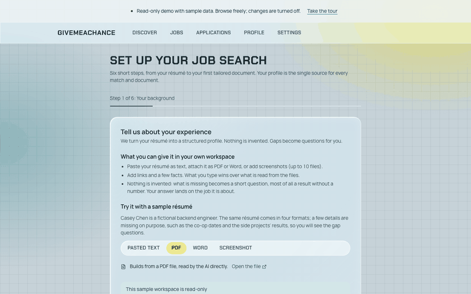
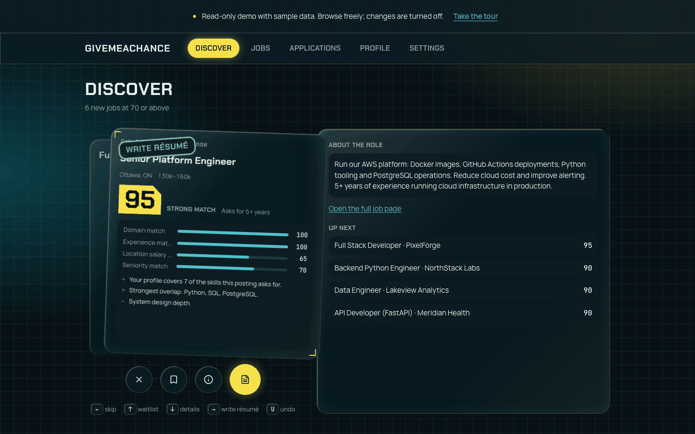
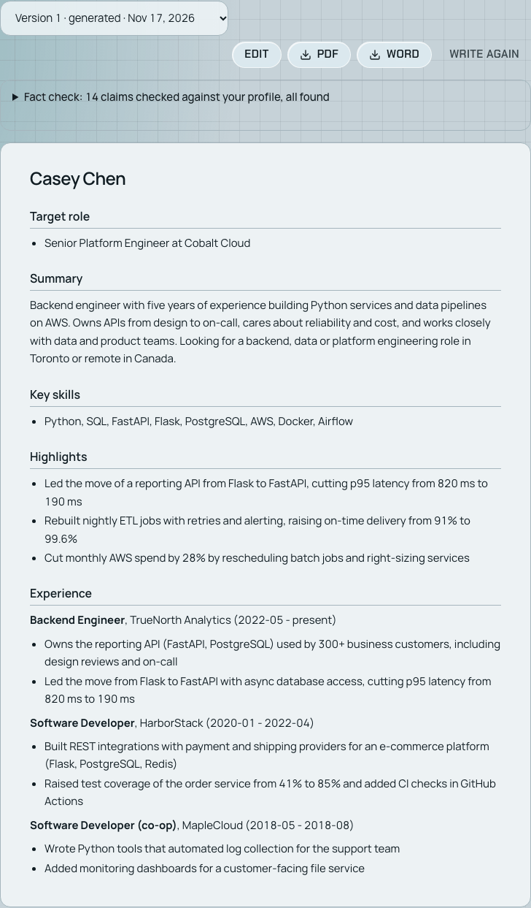
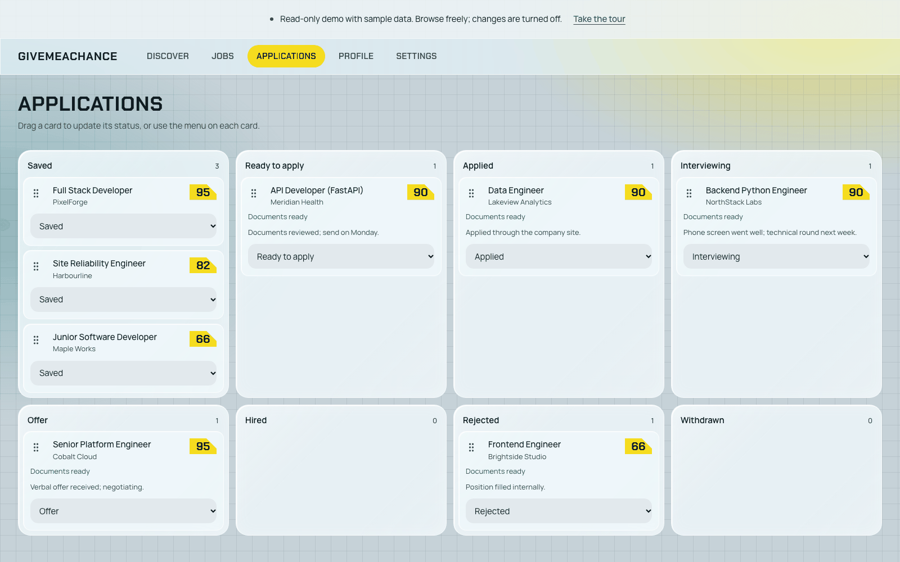
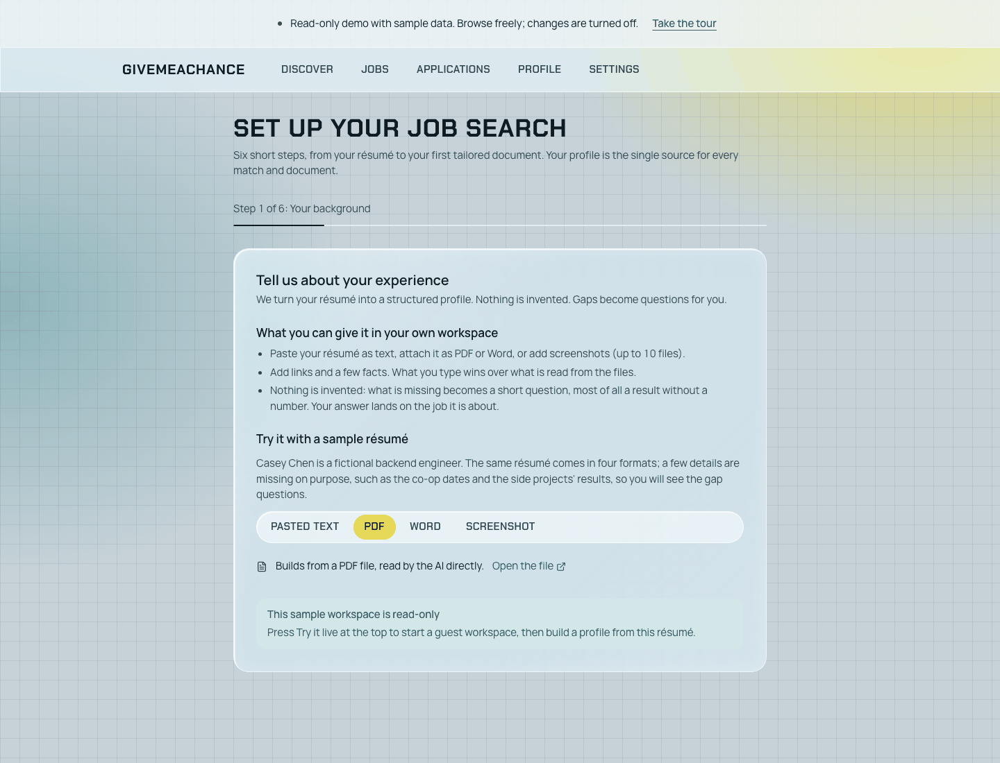
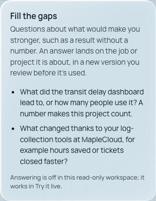
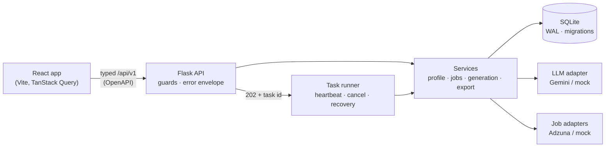

# GivemeaChance

[](https://github.com/beandecode/givemeachance/actions/workflows/ci.yml)

A job-search assistant that tells you **which jobs are worth your time and why**, and writes a tailored résumé and
cover letter only for the ones you pick.



## The problem

Applying well is slow: you read every posting, compare it with your background and write a résumé that fits. Most
tools either send one résumé everywhere or let a model invent experience you don't have.

## What it does

1. **Builds a profile** from your résumé (text, PDF, Word or image). You review and approve it, and every later step
   uses only that.
2. **Finds jobs** on the Adzuna job board with your saved filters, or takes a posting you paste, and reads each one in
   full.
3. **Explains the fit**: a score with strengths, gaps and risks.
4. **Lets you decide fast** in a swipe deck: write a résumé, skip, waitlist or open the details.
5. **Writes the documents** for the jobs you pick, then checks every claim against your profile and shows what it
   couldn't support. Export to PDF or Word.
6. **Tracks applications** from draft to offer, with follow-up dates.

## Try it

**Live demo: <https://jobs.givemeachance.qzz.io/>** (works on a phone). It opens a read-only sample workspace with a
short guided tour. **Try it live** gives you a guest workspace where search, scoring and writing run for real, on a
sample profile and a small daily budget.

How the scoring was measured is in the **[case study](https://jobs.givemeachance.qzz.io/case-study)**.

To run the read-only demo locally, no account or keys needed:

```bash
docker compose -f docker-compose.demo.yml up --build
open http://127.0.0.1:5021/app/
```

## How well it scores

I collected 48 real Toronto postings and labelled 47 of them by hand for an early-career data-science résumé before seeing any score
([method](docs/adr/ADR-019-full-job-descriptions.md)). "Ranked right" here means the share of pairs the score puts in
my order; 0.50 is a coin flip.

| | Before (preview, old model) | Now (full description, `gemini-3.5-flash-lite`) |
|---|---|---|
| Level: roles that fit ranked above roles that ask for more experience | 0.68 | 0.83 |
| Jobs I'd apply to ranked above jobs I'd skip | 0.65 | 0.76 |
| Postings whose text states the years of experience asked for | 1 of 48 | 39 of 48 |

With this few postings the intervals are wide (see the case study). Fitting roles that reach the swipe deck went from
1 of 17 to 7 of 17, and none of the 13 jobs in the deck is one I'd skip. `python scripts/labelling.py report` reproduces the numbers, and
[ADR-019](docs/adr/ADR-019-full-job-descriptions.md#model-comparison-2026-11-16) compares four models.

The score describes fit; whether to apply stays your call.

## How it is checked

- Python, web unit and browser tests run on every push, on mock providers and temporary databases.
- The API is fuzzed against its OpenAPI document, and the web app's types are generated from it.
- Every screen passes automated accessibility checks (WCAG 2.1 AA) in light, dark and no-transparency modes, on phone,
  tablet and desktop sizes.
- A test fails any code that holds a database write lock while calling an AI or job-board provider.

## Screenshots

| Discover | Match report |
|---|---|
|  |  |
| **Tailored résumé** | **Application board** |
|  |  |
| **Résumé input** | **Fill the gaps** |
|  |  |

On a phone:


Regenerate the images and GIFs with `(cd web && npm run screenshots)` and `python scripts/make_readme_gif.py`.

## Architecture



## Design decisions

- **Modular monolith on SQLite** — one deployable; another database or a queue only when a measurement calls for it
  ([ADR-001](docs/adr/ADR-001-modular-monolith-first.md), [ADR-004](docs/adr/ADR-004-sqlite-then-postgresql.md)).
- **No transaction across a provider call** — the write lock is released before every AI or job-board request and
  state is re-checked afterwards.
- **Background tasks** — long work runs as a task that survives restarts and can be cancelled
  ([ADR-002](docs/adr/ADR-002-async-task-contract.md)).
- **Typed API** — the web app's types are generated from the committed OpenAPI document
  ([ADR-006](docs/adr/ADR-006-typed-api-layer.md), [ADR-008](docs/adr/ADR-008-react-spa.md)).
- **Pure-Python PDF/DOCX export** — nothing to install on the host ([ADR-007](docs/adr/ADR-007-pure-python-export.md)).
- **Honest AI output** — a blocked or empty model response is an error, never a made-up score; documents are written
  only from an approved profile, for a match you have seen.
- **Scored from the full posting** — the job board's API returns only a preview, so the full text is read from the
  posting's page ([ADR-019](docs/adr/ADR-019-full-job-descriptions.md)).
- **One accessible design** — the same glassy look on phone and desktop, from design tokens in one file
  ([ADR-012](docs/adr/ADR-012-neon-glass-design-language.md), [ADR-011](docs/adr/ADR-011-design-language-and-fonts.md)).
- **Safe public demo** — the sample workspace refuses every change; guest workspaces run on daily budgets, can only do
  a fixed set of things and are deleted after a day ([ADR-009](docs/adr/ADR-009-read-only-demo-mode.md),
  [ADR-018](docs/adr/ADR-018-live-demo-guest-workspaces.md)).

## Tech stack

Python 3.12 · Flask · SQLite · Pydantic · Gemini API · Adzuna API · React + TypeScript (Vite, TanStack Query, Tailwind) ·
Docker Compose · Cloudflare Tunnel. Architecture: [docs/architecture.md](docs/architecture.md).

Fonts: [Chakra Petch](https://github.com/m4rc1e/Chakra-Petch), [Manrope](https://github.com/sharanda/manrope) and [JetBrains Mono](https://github.com/JetBrains/JetBrainsMono), self-hosted Latin subsets under the SIL Open Font License 1.1 (`web/src/assets/fonts/OFL-*.txt`).

## Quick start

```bash
mise trust && mise install       # Python and Node from mise.toml (https://mise.jdx.dev); creates .venv
./.venv/bin/pip install --require-hashes -r requirements.txt
(cd web && npm ci && npm run build)   # the web app, served by Flask at /app
export FLASK_SECRET_KEY="$(./.venv/bin/python -c 'import secrets; print(secrets.token_urlsafe(48))')"

# Mock providers, no API keys; REGISTRATION_MODE=open allows sign-up
REGISTRATION_MODE=open SETTINGS_FILE=config/settings.test.yaml ./.venv/bin/python run.py
```

Open http://127.0.0.1:5001/app/ and create an account. For real providers, copy `config/api-keys.env.example` to
`config/api-keys.env`, add the Gemini and Adzuna keys, and run `./.venv/bin/python run.py`. Docker and hosting: [docs/operations.md](docs/operations.md).

## Tests

```bash
./.venv/bin/pip install -r requirements-dev.txt
(cd web && npm ci && npx playwright install --only-shell chromium)
./.venv/bin/pytest -q            # unit + integration, mock providers, temporary databases
bash scripts/verify.sh           # full gate, including web unit tests and browser tests
```

## Documentation

| Doc | For |
|---|---|
| [CONTRIBUTING.md](CONTRIBUTING.md) | Contributors: start here |
| [docs/usage.md](docs/usage.md) | Using the app |
| [docs/architecture.md](docs/architecture.md) | How it's built |
| [docs/api.md](docs/api.md) · [docs/error-codes.md](docs/error-codes.md) | HTTP API |
| [docs/operations.md](docs/operations.md) | Running, testing, measuring, Docker |
| [docs/roadmap.md](docs/roadmap.md) | What's next |
| [docs/adr/](docs/adr/) | Architecture decisions |
